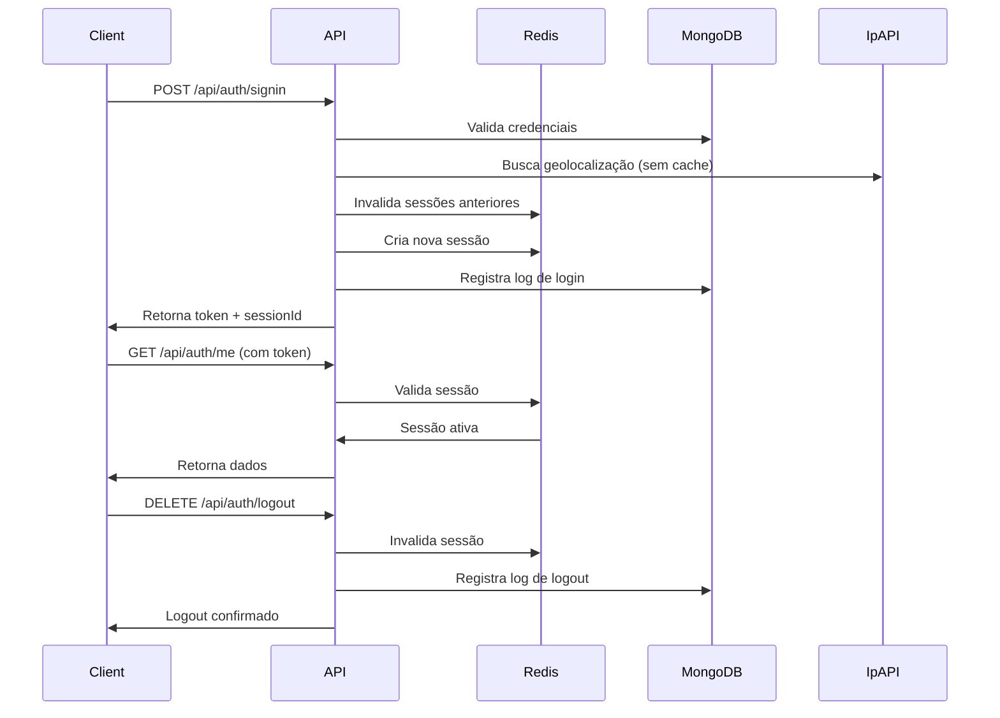

# Backend Base TS - Doc Auth Routes Guide

Use this skill when you need guidance from docs/AUTH_ROUTES_GUIDE.md in backend-base-ts.

## Quick Start

1. Read the existing implementation and impacted module boundaries.
2. Apply this skill guidance before editing code.
3. Validate with lint, build, and tests before finishing.

## When to Use This Skill

- When the task scope matches this skill name and domain.
- When reviewing or implementing related backend changes.
- When enforcing repository conventions for this topic.

## Project Setup Checklist

- [ ] Keep module and shared boundaries intact.
- [ ] Keep controllers thin and service-driven.
- [ ] Keep DI wiring and route aggregation correct.
- [ ] Update docs when contracts or behavior change.
- [ ] Run: npm run lint, npm run build, npm run test.

## Reference Guidance

# Guia de Rotas de Autenticação e Sessão

## Objective
Apply the canonical guidance from docs/AUTH_ROUTES_GUIDE.md without diverging from repository standards.

## When to use

- When implementing or refactoring behavior covered by this document.
- When reviewing changes that touch the same concerns.
- When validating architecture, contracts, or operational rules described here.

## Source document

- docs/AUTH_ROUTES_GUIDE.md

## Canonical guidance

# Guia de Rotas de Autenticação e Sessão

## 📌 Visão Geral

Todas as rotas de autenticação e gerenciamento de sessão estão centralizadas no **authRouter** (`/api/auth`).

## 🔓 Rotas Públicas

### POST `/api/auth/signup`
Cadastra um novo usuário no sistema.

**Body:**
```json
{
  "username": "joao.silva",
  "email": "joao.silva@example.com",
  "password": "senha123",
  "setor": "TI"
}
```

**Response (201):**
```json
{
  "_id": "507f1f77bcf86cd799439011",
  "username": "joao.silva",
  "email": "joao.silva@example.com",
  "setor": "TI",
  "createdAt": "2026-04-18T10:30:00.000Z"
}
```

---

### POST `/api/auth/signin`
Faz login no sistema. **Cria automaticamente uma sessão no Redis** e invalida todas as sessões anteriores do mesmo usuário (sessão única por usuário).

**Body:**
```json
{
  "login": "joao.silva@example.com",
  "password": "senha123"
}
```

O campo `login` aceita email ou username. Para compatibilidade, a API também aceita `email` ou `username` no body.

Exemplo com username:

```json
{
  "login": "joao.silva",
  "password": "senha123"
}
```

**Response (200):**
```json
{
  "_id": "507f1f77bcf86cd799439011",
  "email": "joao.silva@example.com",
  "roles": ["Usuario"],
  "isAdmin": false,
  "token": "eyJhbGciOiJIUzI1NiIsInR5cCI6IkpXVCJ9...",
  "refreshToken": "eyJhbGciOiJIUzI1NiIsInR5cCI6IkpXVCJ9...",
  "sessionId": "550e8400-e29b-41d4-a716-446655440000",
  "tempo_expiracao_token": "8h"
}
```

**Comportamento:**
- ✅ Busca geolocalização por IP (via API ip-api.com)
- ✅ Invalida todas as sessões anteriores do usuário
- ✅ Cria nova sessão no Redis com TTL
- ✅ Regenera tokens JWT com `sessionId` incluído
- ✅ Registra log de login com localização

**Geolocalização:**
- IPs privados/locais são ignorados (retorna `null`)
- Não usa cache Redis - consulta direta à API
- Não bloqueia o login se falhar

---

### POST `/api/auth/refresh`
Renova o token de acesso usando o refresh token.

**Body:**
```json
{
  "refreshToken": "eyJhbGciOiJIUzI1NiIsInR5cCI6IkpXVCJ9..."
}
```

**Response (200):**
```json
{
  "token": "eyJhbGciOiJIUzI1NiIsInR5cCI6IkpXVCJ9...",
  "refreshToken": "eyJhbGciOiJIUzI1NiIsInR5cCI6IkpXVCJ9..."
}
```

---

## 🔒 Rotas Protegidas

> **Todas as rotas abaixo requerem header:** `Authorization: Bearer <token>`

### GET `/api/auth/me`
Retorna informações do usuário autenticado.

**Response (200):**
```json
{
  "_id": "507f1f77bcf86cd799439011",
  "username": "joao.silva",
  "email": "joao.silva@example.com",
  "roles": ["Usuario"],
  "setor": "TI",
  "avatar_url": "https://...",
  "pagina_inicial": "/dashboard"
}
```

---

### GET `/api/auth/abilities`
Retorna as permissões e habilidades do usuário autenticado.

**Response (200):**
```json
{
  "abilities": [
    { "action": "read", "subject": "User" },
    { "action": "create", "subject": "Report" }
  ]
}
```

---

## 🔐 Rotas de Gerenciamento de Sessão

### GET `/api/auth/sessions`
Lista todas as sessões ativas do usuário logado.

**Response (200):**
```json
[
  {
    "sessionId": "550e8400-e29b-41d4-a716-446655440000",
    "userId": "507f1f77bcf86cd799439011",
    "email": "joao.silva@example.com",
    "ip": "200.123.45.67",
    "userAgent": "Mozilla/5.0 (Windows NT 10.0; Win64; x64)...",
    "location": {
      "country": "Brazil",
      "region": "São Paulo",
      "city": "São Paulo",
      "lat": -23.5505,
      "lon": -46.6333,
      "timezone": "America/Sao_Paulo"
    },
    "createdAt": "2026-04-18T10:30:00.000Z",
    "lastActivityAt": "2026-04-18T12:45:00.000Z",
    "expiresAt": "2026-04-18T18:30:00.000Z",
    "isActive": true
  }
]
```

---

### GET `/api/auth/sessions/current`
Retorna detalhes da sessão atual (sessão do token usado na requisição).

**Response (200):**
```json
{
  "sessionId": "550e8400-e29b-41d4-a716-446655440000",
  "userId": "507f1f77bcf86cd799439011",
  "email": "joao.silva@example.com",
  "ip": "200.123.45.67",
  "userAgent": "Mozilla/5.0...",
  "location": {
    "country": "Brazil",
    "region": "São Paulo",
    "city": "São Paulo"
  },
  "createdAt": "2026-04-18T10:30:00.000Z",
  "lastActivityAt": "2026-04-18T12:45:00.000Z",
  "isActive": true
}
```

---

### DELETE `/api/auth/logout`
Faz logout da **sessão atual** (invalida o sessionId do token).

**Response (200):**
```json
{
  "message": "Logout realizado com sucesso"
}
```

**Comportamento:**
- ✅ Invalida a sessão atual no Redis
- ✅ Registra log de logout com duração da sessão
- ✅ Token JWT continua válido mas sessão é rejeitada pelo `authMiddleware`

---

### DELETE `/api/auth/logout-all`
Faz logout de **todas as sessões** do usuário.

**Response (200):**
```json
{
  "message": "3 sessão(ões) encerrada(s) com sucesso",
  "count": 3
}
```

**Comportamento:**
- ✅ Invalida todas as sessões do usuário no Redis
- ✅ Útil para "sair de todos os dispositivos"

---

## 🔄 Fluxo de Autenticação Completo



---

## 🛡️ Middleware de Sessão

O **authMiddleware** valida **DUAS coisas**:

1. **Token JWT** - Validade, assinatura, expiração
2. **Sessão Redis** - Se o `sessionId` do token ainda está ativo

```typescript
// Exemplo de validação
verifyToken(req, res, next) {
  // 1. Valida JWT
  const decoded = jwt.verify(token, secret);

  // 2. Valida sessão no Redis
  const session = await redis.get(`SESSION:USER:${decoded.id}:${decoded.sessionId}`);

  if (!session || !session.isActive) {
    return res.status(401).json({ message: 'Sessão inválida ou expirada' });
  }

  // 3. Atualiza lastActivityAt (debounce de 1 minuto)
  await redis.updateLastActivity(decoded.sessionId);

  next();
}
```

---

## 📊 Logs Automáticos

### Logs de Sessão
Registrados automaticamente em MongoDB:

```javascript
// Login
{
  action: "LOGIN",
  category: "SESSION_LOG",
  message: "Login realizado com sucesso - São Paulo, SP - Brasil",
  created_by: "joao.silva@example.com",
  ip: "200.123.45.67",
  sessionId: "550e8400-e29b-41d4-a716-446655440000"
}

// Logout
{
  action: "LOGOUT",
  category: "SESSION_LOG",
  message: "Logout realizado - Duração da sessão: 2h 15m",
  created_by: "joao.silva@example.com",
  sessionId: "550e8400-e29b-41d4-a716-446655440000"
}

// Acesso Negado
{
  action: "ACCESS_DENIED",
  category: "SESSION_LOG",
  message: "Acesso negado: Sessão expirada ou encerrada",
  created_by: "joao.silva@example.com"
}
```

---

## 🚨 Erros Comuns

### 401 - Sessão Inválida
```json
{
  "message": "Sessão inválida ou expirada"
}
```
**Causa:** Token válido mas sessão foi encerrada (logout, timeout, ou login em outro dispositivo).
**Solução:** Fazer login novamente.

---

### 401 - Token Inválido
```json
{
  "message": "Token inválido"
}
```
**Causa:** Token JWT malformado, expirado ou assinatura inválida.
**Solução:** Fazer login novamente ou usar refresh token.

---

### 400 - SessionId Não Encontrado
```json
{
  "message": "SessionId não encontrado no token"
}
```
**Causa:** Token foi gerado antes da implementação de sessões.
**Solução:** Fazer login novamente para obter token com sessionId.

---

## 🔧 Configuração

### Tempo de Expiração
Configurado por usuário em `user.tempo_expiracao_token` (padrão: `8h`).

### Formato Aceito
- `30s` - 30 segundos
- `5m` - 5 minutos
- `2h` - 2 horas
- `7d` - 7 dias

### Debounce de Atividade
Para otimizar Redis, `lastActivityAt` é atualizado apenas a cada **1 minuto**.

---

## 📝 Notas Importantes

1. **Sessão Única:** Um usuário só pode ter **uma sessão ativa**. Login em novo dispositivo invalida sessão anterior.
2. **Geolocalização:** Consulta diretamente a API ip-api.com **sem cache Redis**.
3. **IPs Privados:** IPs locais/privados não são geolocalizados.
4. **Fallback Gracioso:** Se geolocalização falhar, login continua normalmente.
5. **Logs Assíncronos:** Logs de sessão são gravados de forma não-bloqueante.

---

## 🔗 Arquivos Relacionados

- **AuthRouter**: [src/modules/users/infra/https/routes/authRouter.ts](../src/modules/users/infra/https/routes/authRouter.ts)
- **SessionController**: [src/modules/session/infra/https/controllers/SessionController.ts](../src/modules/session/infra/https/controllers/SessionController.ts)
- **UsersController**: [src/modules/users/infra/https/controllers/UsersController.ts](../src/modules/users/infra/https/controllers/UsersController.ts)
- **AuthMiddleware**: [src/shared/middlewares/authMiddleware.ts](../src/shared/middlewares/authMiddleware.ts)
- **GetLocationByIpService**: [src/modules/session/services/session/GetLocationByIpService.ts](../src/modules/session/services/session/GetLocationByIpService.ts)

