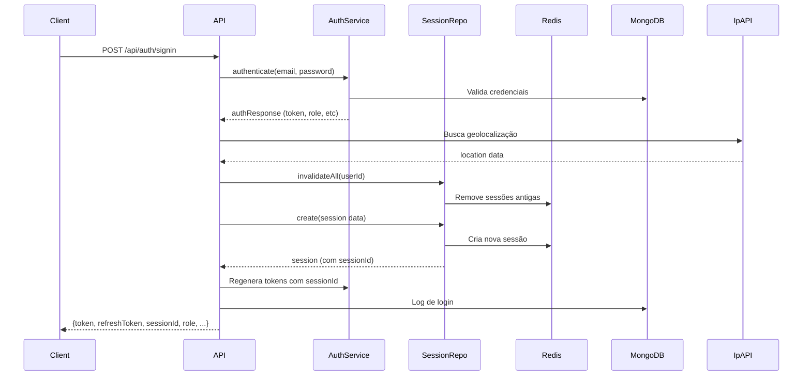

# Backend Base TS - Doc Role Unique Session Changes

Use this skill when you need guidance from docs/ROLE_UNIQUE_SESSION_CHANGES.md in backend-base-ts.

## Quick Start

1. Read the existing implementation and impacted module boundaries.
2. Apply this skill guidance before editing code.
3. Validate with lint, build, and tests before finishing.

## When to Use This Skill

- When the task scope matches this skill name and domain.
- When reviewing or implementing related backend changes.
- When enforcing repository conventions for this topic.

## Project Setup Checklist

- [ ] Keep module and shared boundaries intact.
- [ ] Keep controllers thin and service-driven.
- [ ] Keep DI wiring and route aggregation correct.
- [ ] Update docs when contracts or behavior change.
- [ ] Run: npm run lint, npm run build, npm run test.

## Reference Guidance

# Alterações: Role Único + Sessão no Login

## Objective
Apply the canonical guidance from docs/ROLE_UNIQUE_SESSION_CHANGES.md without diverging from repository standards.

## When to use

- When implementing or refactoring behavior covered by this document.
- When reviewing changes that touch the same concerns.
- When validating architecture, contracts, or operational rules described here.

## Source document

- docs/ROLE_UNIQUE_SESSION_CHANGES.md

## Canonical guidance

# Alterações: Role Único + Sessão no Login

## 📋 Resumo das Mudanças

### 1. **Usuário agora tem UMA única role** (não mais array)

Antes: `roles?: string[] | IRoleDTO[]`
Depois: `role?: string | IRoleDTO`

### 2. **Sessão é criada automaticamente no login**

O endpoint `/api/auth/signin` agora:
- ✅ Cria sessão no Redis automaticamente
- ✅ Invalida sessões anteriores (sessão única por usuário)
- ✅ Retorna `sessionId` na resposta
- ✅ Tokens já incluem o `sessionId`

---

## 🔄 Arquivos Alterados

### DTOs e Interfaces

#### [src/modules/users/dto/IUserDTO.ts](../src/modules/users/dto/IUserDTO.ts)
```typescript
// ANTES
roles?: string[] | IRoleDTO[];

// DEPOIS
role?: string | IRoleDTO;
```

#### [types/express/index.d.ts](../types/express/index.d.ts)
```typescript
// ITokenPayload agora usa role singular
interface ITokenPayload {
  id: string;
  email: string;
  role: string;  // ← Era roles: string[]
  is_admin: boolean;
  sessionId?: string;
  // ...
}
```

---

### Models

#### [src/modules/users/infra/mongo/models/User.ts](../src/modules/users/infra/mongo/models/User.ts)
```typescript
// ANTES
roles: [{ type: Schema.Types.ObjectId, ref: 'Role' }]

// DEPOIS
role: { type: Schema.Types.ObjectId, ref: 'Role' }
```

**⚠️ ATENÇÃO:** Será necessário criar uma **migration** para converter dados existentes no banco:

```javascript
// Migration necessária
db.users.updateMany(
  { roles: { $exists: true } },
  [
    {
      $set: {
        role: { $arrayElemAt: ["$roles", 0] } // Pega a primeira role
      }
    },
    {
      $unset: "roles"
    }
  ]
);
```

---

### Services

#### [src/modules/users/services/auth/AuthenticateUser.ts](../src/modules/users/services/auth/AuthenticateUser.ts)

**Mudanças:**
1. Cria usuário com `role` singular:
```typescript
user = await User.create({
  email,
  password: bcrypt.hashSync(password, 8),
  role: roleIdDefault?._id.toString() || '',  // ← Era roles: [...]
  // ...
});
```

2. Gera token com `role` singular:
```typescript
const roleString = user.role
  ? typeof user.role === 'string'
    ? user.role
    : (user.role as any)?._id?.toString() || String(user.role)
  : '';

let payload = {
  id: user.id,
  email: user.email,
  role: roleString,  // ← Era roles: rolesArray
  is_admin: (await this.usersRepository.isAdmin(email)) ?? false,
  // ...
};
```

3. Retorna `role` na resposta:
```typescript
return {
  token,
  refreshToken,
  role: user.role,  // ← Era roles: user.roles
  // ...
};
```

---

#### [src/modules/users/services/user/CreateService.ts](../src/modules/users/services/user/CreateService.ts)
```typescript
// ANTES
const created = await this.repository.create({
  ...data,
  password: hashedPassword,
  roles: [roleDefault],
});

// DEPOIS
const created = await this.repository.create({
  ...data,
  password: hashedPassword,
  role: roleDefault,
});
```

---

### Controllers

#### [src/modules/users/infra/https/controllers/UsersController.ts](../src/modules/users/infra/https/controllers/UsersController.ts)

**Método `signin` agora:**

1. **Autentica o usuário**
2. **Cria sessão automaticamente:**
```typescript
// Captura IP e User-Agent
const ip = (req.headers['x-forwarded-for'] as string)?.split(',')[0]?.trim() ||
           (req.headers['x-real-ip'] as string) ||
           req.socket.remoteAddress || 'IP não disponível';

const userAgent = req.headers['user-agent'] || 'User-Agent não disponível';

// Busca geolocalização (não bloqueia se falhar)
const location = await getLocationService.execute(ip);

// Invalida todas as sessões anteriores (sessão única)
await sessionRepository.invalidateAll(authResponse._id.toString());

// Cria nova sessão
const session = await sessionRepository.create({
  userId: authResponse._id.toString(),
  email: authResponse.email,
  ip,
  userAgent,
  location: location || undefined,
  expiresIn,
});
```

3. **Regenera tokens com sessionId:**
```typescript
const payloadWithSession = {
  id: authResponse._id.toString(),
  email: authResponse.email,
  role: authResponse.role,  // ← Era roles
  is_admin: authResponse.isAdmin,
  expire_at: authResponse.tempo_expiracao_token || '8h',
  sessionId: session.sessionId,
};

const newToken = generateToken(payloadWithSession);
const newRefreshToken = generateRefreshToken(payloadWithSession);
```

4. **Registra log de login:**
```typescript
await sessionLogService.logLogin({ session });
```

5. **Retorna resposta completa:**
```typescript
res.status(200).json({
  ...authResponse,
  token: newToken,
  refreshToken: newRefreshToken,
  sessionId: session.sessionId,
});
```

---

### Repositories

#### [src/modules/users/infra/mongo/repositories/UsersRepository.ts](../src/modules/users/infra/mongo/repositories/UsersRepository.ts)

**Mudanças:**

1. **Populate de `role` (singular):**
```typescript
protected readonly modelPopulated = [
  {
    path: 'role',  // ← Era 'roles'
    select: '-__v',
  },
  // ...
];
```

2. **Método `isAdmin`:**
```typescript
// ANTES
return user?.roles?.some(
  (role: any) => role?.name === ENameRoleDefault.Administrador,
);

// DEPOIS
return (user?.role as any)?.name === ENameRoleDefault.Administrador;
```

3. **Método `updateManyUsersWithRole`:**
```typescript
// ANTES
await this.model.updateMany(
  { roles: roleName },
  { $addToSet: { roles: new mongoose.Types.ObjectId(idRole) } },
);
return await this.model.find({ roles: idRole });

// DEPOIS
await this.model.updateMany(
  { role: roleName },
  { $set: { role: new mongoose.Types.ObjectId(idRole) } },
);
return await this.model.find({ role: idRole });
```

---

### Middlewares

#### [src/shared/middlewares/authMiddleware.ts](../src/shared/middlewares/authMiddleware.ts)

**Interface do token atualizada:**
```typescript
interface ITokenPayload {
  id: string;
  email: string;
  role: string;  // ← Era roles: string[]
  is_admin: boolean;
  estrutura_rm?: string;
  expire_at?: string;
  sessionId?: string;
  iat?: number;
  exp?: number;
}
```

**O middleware agora:**
1. Valida o JWT
2. **Valida a sessão no Redis** usando o `sessionId` do token
3. Atualiza `lastActivityAt` (com debounce de 1 minuto)
4. Registra logs de acesso negado se sessão inválida

---

## 📊 Fluxo Completo de Login



---

## 🚀 Exemplo de Response do Login

```json
{
  "_id": "507f1f77bcf86cd799439011",
  "email": "joao.silva@example.com",
  "username": "joao silva",
  "role": "507f191e810c19729de860ea",
  "permissaos": [],
  "isAdmin": false,
  "token": "eyJhbGciOiJIUzI1NiIsInR5cCI6IkpXVCJ9...",
  "refreshToken": "eyJhbGciOiJIUzI1NiIsInR5cCI6IkpXVCJ9...",
  "sessionId": "550e8400-e29b-41d4-a716-446655440000",
  "tempo_expiracao_token": "8h",
  "pagina_inicial": "/",
  "setor": "TI",
  "status": "ATIVO",
  "ability": []
}
```

---

## ⚠️ Breaking Changes

### Para o Frontend:

1. **Resposta de login mudou:**
```javascript
// ANTES
response.data.roles  // Array de roles

// DEPOIS
response.data.role   // Uma única role (ObjectId string)
```

2. **Token JWT agora inclui `sessionId`:**
```javascript
// Decodificando o token
const decoded = jwt.decode(token);
console.log(decoded.sessionId);  // "550e8400-e29b-41d4-..."
```

3. **Payload do token mudou:**
```javascript
// ANTES
{
  id: "...",
  email: "...",
  roles: ["507f...", "60af..."],  // Array
  is_admin: true
}

// DEPOIS
{
  id: "...",
  email: "...",
  role: "507f...",  // String única
  is_admin: true,
  sessionId: "550e8400-..."  // Novo campo
}
```

---

### Para o Backend:

1. **Migration necessária no MongoDB:**
```javascript
// Converte roles (array) para role (string único)
db.users.updateMany(
  { roles: { $exists: true, $ne: [] } },
  [
    { $set: { role: { $arrayElemAt: ["$roles", 0] } } },
    { $unset: "roles" }
  ]
);

// Usuários sem role recebem role padrão "Usuario"
const roleUsuario = db.roles.findOne({ name: "Usuario" });
db.users.updateMany(
  { role: { $exists: false } },
  { $set: { role: roleUsuario._id } }
);
```

2. **Endpoints descontinuados/alterados:**
- `POST /api/users/:id/roles` - Adicionar múltiplas roles → Não faz mais sentido
- `DELETE /api/users/:id/roles` - Remover múltiplas roles → Substituir por atualização de role única

3. **Métodos de repositório alterados:**
- `removerRolesByUserId()` - Agora remove a role única (não array)
- `isAdmin()` - Verifica role única ao invés de array

---

## ✅ Vantagens da Nova Abordagem

1. **Simplicidade:** Um usuário = Uma role
2. **Performance:** Menos joins, populate mais rápido
3. **Segurança:** Sessões controladas no Redis
4. **Auditoria:** Todos os logins registrados automaticamente
5. **Controle:** Sessão única por usuário evita múltiplos logins

---

## 📝 Checklist de Migração

- [ ] Executar migration no MongoDB (converter `roles` → `role`)
- [ ] Atualizar frontend para usar `response.data.role` (singular)
- [ ] Atualizar decodificação de token para acessar `decoded.role`
- [ ] Remover/atualizar endpoints de gerenciamento múltiplo de roles
- [ ] Testar login e criação de sessão
- [ ] Verificar logs de auditoria no MongoDB
- [ ] Verificar sessões no Redis (`SESSION:USER:*`)
- [ ] Testar logout e invalidação de sessão
- [ ] Testar login em múltiplos dispositivos (deve invalidar sessão anterior)

---

## 🔗 Documentação Relacionada

- [Guia de Rotas de Autenticação](./AUTH_ROUTES_GUIDE.md)
- [Guia de Enums de Log](./LOG_ENUMS_GUIDE.md)
- [Guia de Sessões](../src/modules/session/README.md)

